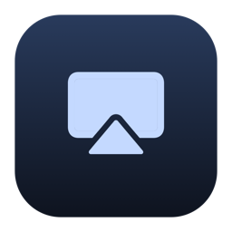
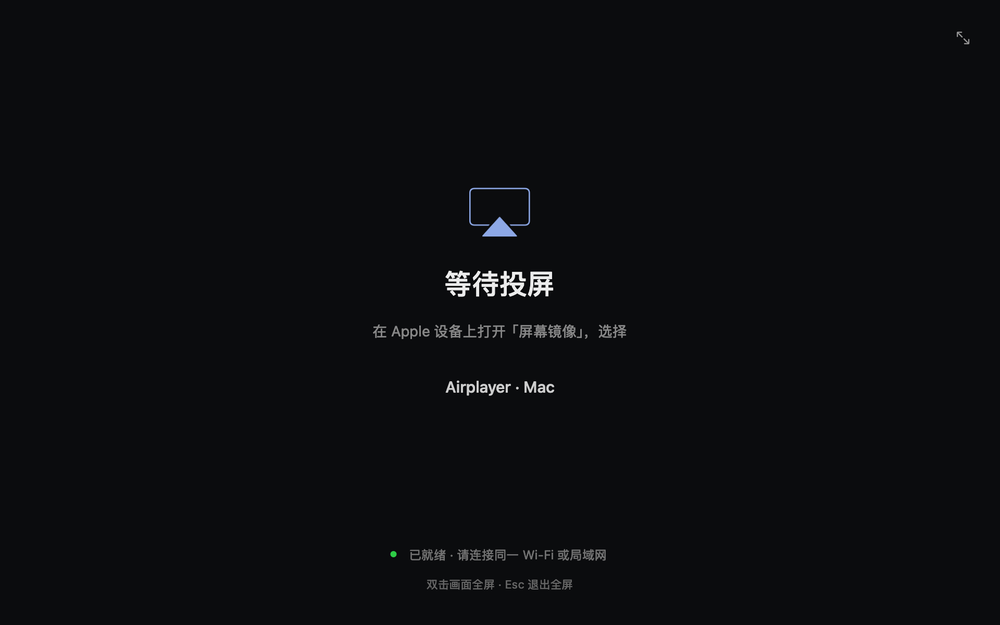

<div align="center">



# Airplayer

**Your screen. On your Mac.**

A focused, native AirPlay mirroring receiver for macOS.

[](LICENSE)


[Download](https://github.com/Graphicmelon/Airplayer/releases) · [中文](docs/README.zh-CN.md) · [Development](docs/DEVELOPMENT.md)



</div>

## Why Airplayer

Open the app, connect from **Screen Mirroring**, and put your screen front and center. No accounts, recording tools, or settings panels.

- **Sharp picture.** Requests up to 2160p at 60 FPS, with HEVC and H.264 support.
- **Responsive motion.** Direct VideoToolbox hardware decoding, without a decoder reorder queue.
- **Synchronized presentation.** Metal and Core Animation present complete frames to prevent scanout tearing.
- **Native window.** Resize, go fullscreen, or double-click the picture. Audio plays through your Mac.
- **Self-contained.** The app bundles its receiver and runtime; users do not need Homebrew.

Built on [UxPlay](https://github.com/FDH2/UxPlay), with a Swift/AppKit interface and an IOSurface-backed Metal renderer. The interface currently uses Simplified Chinese.

## Install

1. Download the app ZIP from [Releases](https://github.com/Graphicmelon/Airplayer/releases).
2. Extract it and move **Airplayer.app** to **Applications**.
3. Open Airplayer and allow local-network access when prompted.
4. On an iPhone, iPad, or Mac on the same network, open **Screen Mirroring** and choose **Airplayer · your Mac**.

**The v1.0.0 binary requires Apple Silicon and macOS 27.0 or later.** It is ad-hoc signed, not Developer ID signed or notarized. macOS may require approval in **System Settings → Privacy & Security**. The source targets macOS 14+, but bundled dependency requirements determine each build's actual minimum OS.

| Action | Shortcut |
| --- | --- |
| Toggle fullscreen | Double-click, green window button, or `⌃⌘F` |
| Leave fullscreen | `Esc` |
| Quit | `⌘Q` |

The sender chooses the actual resolution, codec, and frame rate. 2160p60 is a requested maximum, not a guarantee. Performance depends on the device, display, and network. DRM-protected content is not supported.

## Build

Install Xcode Command Line Tools and [Homebrew](https://brew.sh), then:

```sh
git clone https://github.com/Graphicmelon/Airplayer.git
cd Airplayer
brew install cmake pkgconf libplist openssl@3 gstreamer
bash Scripts/build.sh
open dist/Airplayer.app
```

UxPlay **v1.73.6** is included in `Vendor/`; no submodule checkout is needed. Build outputs stay in `.build/` and `dist/`.

```sh
bash Scripts/test.sh          # Transport and lifecycle
bash Scripts/test_decoder.sh  # H.264 / HEVC hardware decode
bash Scripts/test.sh --ui     # GPU, windows, reconnect, and 2160p pipeline
```

Hardware and UI tests need a logged-in macOS desktop session. See [Development](docs/DEVELOPMENT.md) for architecture, diagnostics, and packaging.

## Contributing

Bug reports and focused pull requests are welcome. Include your Mac, macOS version, sender, and reproduction steps. See [CONTRIBUTING.md](CONTRIBUTING.md).

## License & credits

[GPL-3.0-or-later](LICENSE). Built with UxPlay, GStreamer, and Apple's system frameworks. Dependency notices, pinned source information, and redistribution details are in [THIRD_PARTY.md](THIRD_PARTY.md).

Airplayer is an independent project and is not affiliated with Apple. AirPlay is a trademark of Apple Inc.
