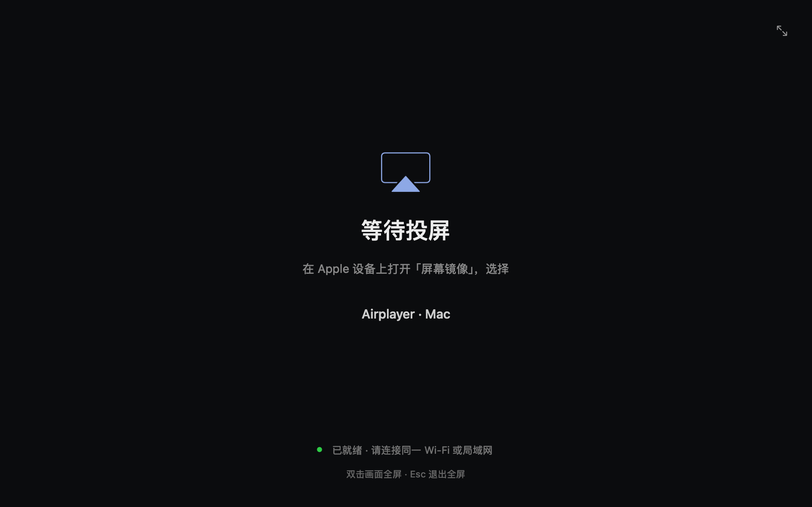

# Airplayer

**把你的屏幕，投到 Mac 上。**

轻量的原生 macOS AirPlay 投屏接收器。打开应用，在发送设备的「屏幕镜像」中连接，即可开始。

[下载](https://github.com/Graphicmelon/Airplayer/releases) · [English](../README.md) · [开发文档](DEVELOPMENT.md)



## 特点

- **清晰：**默认请求 2160p60，支持 HEVC 与 H.264。
- **跟手：**VideoToolbox 硬件即时解码，不积攒解码重排队列。
- **完整帧同步：**Metal 垂直同步配合 Core Animation 合成，避免扫描撕裂。
- **原生体验：**自由缩放、双击全屏、Esc 退出全屏，声音通过 Mac 播放。
- **开箱即用：**运行库随应用打包，无需安装 Homebrew。无账号、录制或复杂设置。

基于 [UxPlay](https://github.com/FDH2/UxPlay)，使用 Swift/AppKit 界面和 IOSurface/Metal 显示。当前界面为简体中文。

## 安装与使用

1. 从 [Releases](https://github.com/Graphicmelon/Airplayer/releases) 下载 ZIP，解压后将 **Airplayer.app** 拖入「应用程序」。
2. 打开应用，并允许本地网络访问。
3. 在同一网络中的 iPhone、iPad 或 Mac 上打开「屏幕镜像」，选择 **Airplayer · 你的 Mac 名称**。

**v1.0.0 预编译版要求 Apple Silicon、macOS 27.0 或以上。** 当前采用 ad-hoc 签名，未经过 Developer ID 签名和公证；首次运行可能需要在「系统设置 → 隐私与安全性」中允许打开。源码使用 macOS 14+ API，但构建产物的最低系统版本取决于打包的依赖。

双击画面或按 `⌃⌘F` 切换全屏，`Esc` 退出全屏，`⌘Q` 退出应用。

2160p60 是请求上限，实际尺寸、编码和帧率由发送设备决定。流畅度受设备、显示器和网络影响。不支持受 DRM 保护的视频。

## 从源码构建

安装 Xcode Command Line Tools 和 Homebrew 后执行：

```sh
git clone https://github.com/Graphicmelon/Airplayer.git
cd Airplayer
brew install cmake pkgconf libplist openssl@3 gstreamer
bash Scripts/build.sh
open dist/Airplayer.app
```

UxPlay v1.73.6 源码已包含在仓库中。测试、架构和诊断方式见[开发文档](DEVELOPMENT.md)。

## 贡献与许可

欢迎提交可复现的问题和聚焦的改进，见[贡献指南](../CONTRIBUTING.md)。采用 [GPL-3.0-or-later](../LICENSE)，第三方组件见 [THIRD_PARTY.md](../THIRD_PARTY.md)。

Airplayer 是独立项目，与 Apple 无隶属关系。AirPlay 是 Apple Inc. 的商标。
